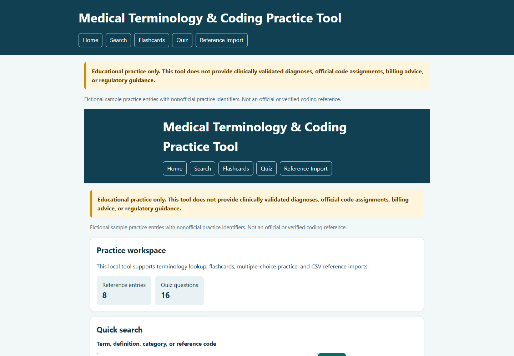

# Medical Terminology & Coding Practice Tool

A small, beginner-friendly local web application for looking up terminology, reviewing flashcards, taking a multiple-choice quiz, and importing a reference CSV. It runs with Python's standard library and does not need internet access.

> **Educational practice only.** This tool does not provide clinically validated diagnoses, official code assignments, billing advice, or regulatory guidance. The bundled identifiers and mappings are fictional, nonofficial practice examples. Imported references are displayed as supplied and are not independently verified.

## Why this is useful for a beginner portfolio

The project demonstrates practical Python skills with CSV parsing, validation, search, quiz scoring, session state, HTML escaping, a local HTTP server, and CSV export, while clearly separating practice material from authoritative coding systems.

## Features

- Search entries by term, definition, category, or reference code, with a category filter.
- Review one flashcard at a time, reveal its definition/reference entry, advance, and shuffle.
- Take a multiple-choice quiz with both term-to-definition and term-to-practice-identifier questions. Questions do not repeat in a round; scoring is shown as the learner answers.
- Import a reference CSV through the local interface. Required columns are checked; duplicate terms/codes and blank reference/source fields generate warnings.
- Download quiz answers and a session summary as a CSV with a fixed, safe filename pattern.
- Imported values are HTML-escaped. The local server validates form fields and uploads, and state-changing forms use per-session CSRF tokens.

## Requirements

Python 3.10 or later. No third-party packages, internet access, cloud account, external API, or web server installation is needed. `requirements.txt` states that Python's standard library is sufficient.

## Launch locally

From this project folder, run:

```powershell
python app.py
```

Open the printed address, normally `http://127.0.0.1:8000/`, in your browser. Stop the server with **Ctrl+C**. To choose another local port, use `python app.py --port 8080`.

## Publish on GitHub and deploy on Render

1. Create a new, empty repository on [GitHub](https://github.com/), without adding a README or license if this project already has them.
2. In PowerShell, open this project folder. This project folder currently has no Git repository, so initialize one and connect it to your new GitHub repository (replace the URL with your repository URL):

   ```powershell
   git init -b main
   git add app.py quiz.py reference_data.py sample_data requirements.txt tests README.md render.yaml .gitignore
   git commit -m "Prepare practice tool for Render deployment"
   git remote add origin https://github.com/YOUR-USERNAME/YOUR-REPOSITORY.git
   git push -u origin main
   ```

   Review the staged file list before committing. Do not add real patient data, credentials, or reference data you do not have permission to publish. If you already initialized this folder or configured `origin` yourself, skip the applicable initialization/remote command; use `git remote set-url origin ...` if the existing remote URL needs changing.
3. Sign in to [Render](https://render.com/) and choose **New + → Blueprint**. Connect the GitHub repository and select its `main` branch. Render reads the included `render.yaml` to create the web service; the app uses Render's assigned `PORT` and binds to the public interface there.
4. Wait for the first deploy to finish. In the Render service page, open **Settings** or the service overview and find its **URL** (usually ending in `.onrender.com`). That is the public website link to share.
5. Open the URL and try Home, Search, Flashcards, Quiz, Reference Import (use only fictional or properly licensed data), and the quiz CSV download. Do not enter real patient information.

Render's free web services may sleep after a period without activity, so the first visit after inactivity can take longer. This app stores sessions and imported datasets only in process memory: they are temporary, can disappear on restart/redeploy, and are not shared between service instances.

## Sample reference data

The built-in sample is `sample_data/reference_terms.csv`. Its identifiers (`PRACTICE-001`, etc.) are **nonofficial practice identifiers** and do not represent ICD, SNOMED CT, CPT, or any other official code system. Definitions and explanations are simplified demonstrations, not verified clinical references.

Expected CSV columns and example row:

```csv
term,definition,category,reference_code,explanation,source_name,source_version
Example term,A short practice definition,General terminology,PRACTICE-101,Practice explanation only,Instructor-provided dataset,1.0
```

Use **Reference Import** in the application to select a CSV file. The uploaded rows replace the sample reference only in that browser session while the server process is running; the tool does not write or alter the uploaded file. Source name and version appear as supplied. Blank source details remain blank and are identified as missing; nothing is filled in automatically. Duplicate names and codes are retained and reported for review. You are responsible for checking the source, version, license, and permissions for any external dataset you import. Do not import proprietary data unless you are entitled to use it.

## Quiz results

Use **Download session results CSV** in Quiz mode. The download contains a timestamp, each question, selected and expected answers, correctness, score percentage, explanations, and a final session summary. The download filename uses a fixed `quiz-results-YYYYMMDD-HHMMSS.csv` pattern. Quiz results and imported data are held in server memory for the session; they are not stored in a database and are cleared when the server stops.

## Tests

Run the standard-library unit tests from this folder (the suite includes local HTTP and security checks):

```powershell
python -m unittest discover -s tests -v
```

## Screenshot



## Project structure

```text
04-medical-coding-practice-tool/
├── app.py                         # local HTTP server and web interface
├── reference_data.py               # CSV validation, duplicate warnings, search
├── quiz.py                         # question generation, scoring, CSV export
├── sample_data/
│   └── reference_terms.csv         # fictional practice examples
├── requirements.txt                # no third-party dependencies
├── README.md
├── .gitignore
└── tests/
    └── test_tool.py
```

## Limitations and safe use

This is a learning tool, not a clinical, diagnostic, billing, or official coding system. It does not validate diagnoses, assign official codes, provide regulatory guidance, or replace qualified review. Even imported data with source metadata is not independently verified by this application. No real patient data should be entered. This small standard-library server is not production-secure: it has no persistent database, session expiry or storage limits, rate limiting, account access controls, or multi-instance session sharing. Sessions, imported references, and quiz results remain in memory and may be lost on restart or when a hosted instance sleeps/restarts. Use it for fictional educational practice only.
