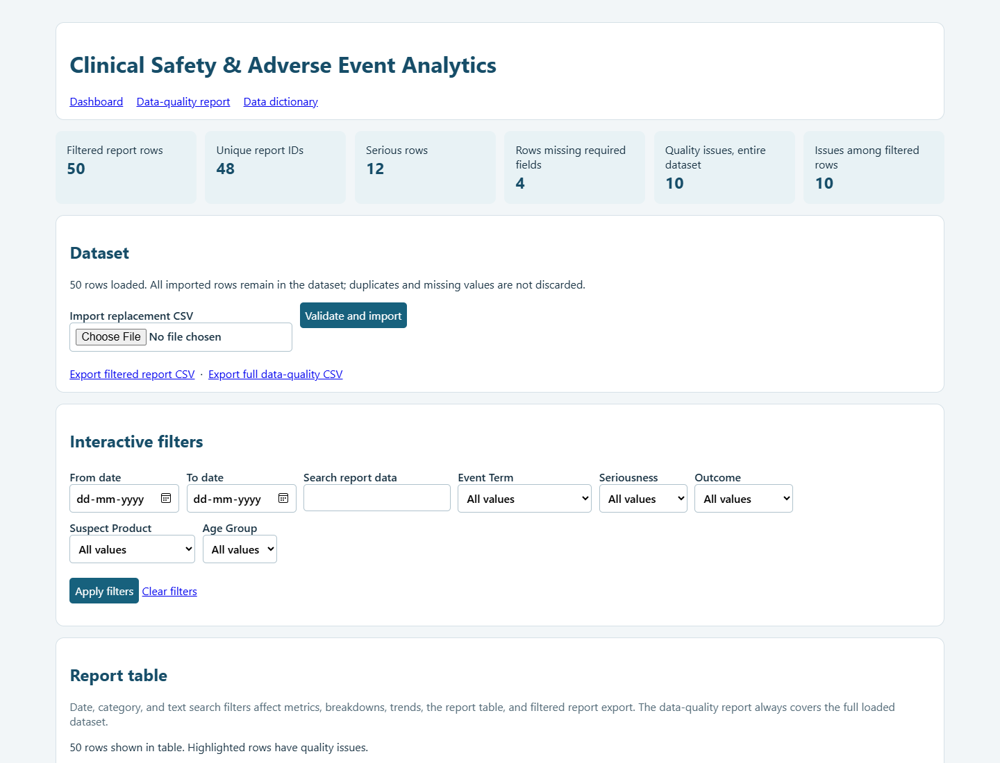

# Project 06: Clinical Safety & Adverse Event Analytics Dashboard

A small local dashboard for exploring a fictional adverse-event report dataset. It demonstrates descriptive pharmacovigilance analytics, CSV validation, transparent data-quality reporting, filtering, and exports using Python's standard library.

> **Educational pharmacovigilance analytics using synthetic data. Report counts do not establish causality, incidence, or a validated safety signal. This tool is not for clinical decision-making or regulatory submission.**

The included 50 rows are synthetic. This dashboard does not diagnose patients, infer causality, detect validated safety signals, or replace professional review. Do not use it to make clinical or regulatory decisions. For portfolio demonstrations, use fictional data. Import external data only when you have appropriate permission; properly de-identified or fictional data is preferred.

## Requirements and launch

- Python 3.9 or later (tested with Python 3.11).
- Standard library only; no package installation or network access is required.

From this project folder:

```powershell
python app.py
```

Open <http://127.0.0.1:8000>. Press `Ctrl+C` in the terminal to stop the local server. The app binds to localhost. Imported rows are held in memory for the browser session and are cleared when the server restarts.

## Dashboard features

- Overview metrics distinguish report rows from unique non-empty report IDs.
- Breakdowns for event term, seriousness, outcome, suspect product, age group, and report source.
- Monthly report-row counts based only on valid dates.
- Date range, category, and free-text filters. These affect dashboard metrics, breakdowns, trends, table, and filtered report CSV.
- Searchable, scrollable table with rows that have data-quality findings highlighted.
- Separate full-dataset data-quality page and issue CSV export. Quality findings remain available even while dashboard filters are applied.
- CSV import validates the required schema and row structure. Duplicate IDs and data-quality issues are reported, not removed or repaired.

## Sample data and fields

The starter dataset is [`sample_data/adverse_event_reports.csv`](sample_data/adverse_event_reports.csv); field meanings, allowed values, and intentional quality examples are in [`sample_data/data_dictionary.md`](sample_data/data_dictionary.md). It includes synthetic product labels and contains no real patient details. Several rows deliberately include duplicate IDs, missing fields, an invalid date, and unrecognized categorical values so the quality report has examples to find.

Required CSV columns are:

```text
report_id,report_date,event_term,seriousness,outcome,suspect_product,age_group,country,report_source,follow_up_received
```

Dates should be valid ISO dates (`YYYY-MM-DD`). Expected categorical values are documented in the data dictionary. The app preserves source strings as imported; it does not silently normalize or drop them. Invalid or missing dates are omitted from monthly counts and remain visible in the quality report. A malformed file structure, missing column, duplicate header, or short/long row is rejected with an error. A structurally valid file with duplicate IDs or missing values is accepted so the issues can be inspected.

Use **Import replacement CSV** on the dashboard to load another dataset into the current session. Import replaces the session's current dataset only after structural validation succeeds. Files are limited to 2 MB.

## Calculation definitions

- **Report row:** one row in the imported CSV. Duplicate rows are retained.
- **Unique report ID:** a distinct non-empty report identifier. IDs are trimmed only when checking whether an identifier is blank or duplicated; imported source text remains unchanged.
- **Serious report:** a row whose `seriousness` value exactly equals `Serious`. Seriousness is not inferred from the event description.
- **Missing-required-fields metric:** number of rows with one or more blank required field values. The separate issue report records each blank field individually.
- **Data-quality issue:** a detected problem that may need review; one row can have multiple issues. Both occurrences of a duplicated ID are flagged.
- **Monthly report count:** count of rows with valid calendar dates grouped by calendar month. Invalid and blank dates are excluded from monthly aggregation, not removed from the source table.
- **Breakdowns:** counts of submitted rows by the exact source value. Missing categorical values are labeled `(Missing)` in the chart; unrecognized non-empty values remain distinct.

These are descriptive counts with no population denominator. They do not measure incidence, establish product causality, or prove a safety signal. Reporting trends may change with follow-up submissions, reporting practices, duplicate records, missing values, and other factors.

## Filters and exports

Select a date range and/or category values, optionally search across report fields, then apply the filters. The dashboard recalculates its metrics and charts using matching rows. **Export filtered report CSV** uses those same date/category/text filters. **Export full data-quality CSV** covers all loaded rows regardless of dashboard filters. Both are generated in memory with CSV quoting and fixed safe filenames; no files are written to disk.

## Tests

Run from this directory:

```powershell
python -m unittest discover -s tests -v
```

Tests cover sample loading, metrics, breakdowns, month grouping, invalid dates, filters, CSV schema handling, empty inputs, data-quality issue detection and preservation, exports, HTTP responses, and safe rendering of HTML-like imported strings.

## Screenshot



## Project structure

```text
app.py                         Local HTTP interface and HTML rendering
analytics.py                   CSV parsing, filters, metrics, trends, report export
data_quality.py                Source-data quality checks
sample_data/adverse_event_reports.csv
sample_data/data_dictionary.md
tests/                         unittest coverage
requirements.txt               Notes standard-library-only setup
```

## Limitations

This is a beginner learning exercise, not a validated pharmacovigilance system. It has no authentication, audit trail, persistent database, access controls, regulatory workflows, denominator data, medical review, or validated signal-detection methods. Session data is in memory and disappears when the server exits. The sample rows are intentionally imperfect and synthetic. Never use the application for patient care, actual safety case processing, clinical decisions, signal conclusions, or regulatory submissions.
